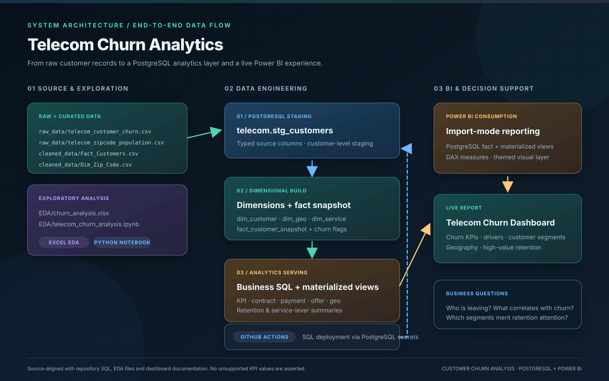
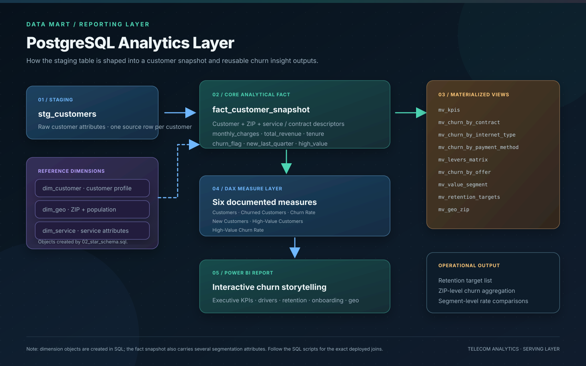

<div align="center">

# Telecom Churn Analytics

**A customer analytics pipeline built around PostgreSQL, exploratory analysis, and Power BI storytelling.**

<a href="https://app.powerbi.com/view?r=eyJrIjoiNjEzYjgwOWUtYmQwZC00ODQyLTlmYmQtMTc0NDg3NzFkNDcwIiwidCI6IjI1Y2UwMjYxLWJiZDYtNDljZC1hMWUyLTU0MjYwODg2ZDE1OSJ9"></a>

[](https://github.com/Sohila-Khaled-Abbas/Customer-Churn-Analysis/actions/workflows/deploy-sql.yml) [](https://github.com/Sohila-Khaled-Abbas/Customer-Churn-Analysis/actions/workflows/render-diagrams.yml)
[](https://www.postgresql.org/)
[](https://powerbi.microsoft.com/)
[](https://www.python.org/)
[](https://jupyter.org/)
[](https://www.microsoft.com/microsoft-365/excel)
[](LICENSE)
[](https://github.com/Sohila-Khaled-Abbas/Customer-Churn-Analysis/commits/main)
[](https://github.com/Sohila-Khaled-Abbas/Customer-Churn-Analysis/stargazers)

**PostgreSQL · SQL · Python · Excel · Power BI · DAX · GitHub Actions**

[Overview](#-project-overview) · [Architecture](#️-solution-architecture) · [PostgreSQL](#-postgresql-analytics-layer) · [EDA](#-exploratory-analysis) · [Power BI](#-power-bi-dashboard) · [Setup](#️-getting-started)

</div>

> An end-to-end analytics project for a fictional telecom provider. It brings customer-level source data through PostgreSQL staging and analytical structures, uses SQL and exploratory analysis to investigate churn patterns, and publishes the resulting KPIs and customer segments through a live Power BI report.

---

## 📌 Project overview

The project explores customer churn from both an analytical and operational perspective. It combines raw and curated customer datasets, geographic context, an Excel analysis workbook, a Python notebook, PostgreSQL transformation scripts, and a Power BI reporting layer.

The repository includes the SQL, data files, EDA materials, Power BI theme, and implementation documentation. The published report is hosted separately in Power BI Service; a PBIX/PBIP report file is not committed in this repository.

## 🏗️ Solution architecture

The architecture separates source exploration, PostgreSQL transformations, analytics serving, and Power BI consumption. GitHub Actions provides a separate, secret-based SQL deployment path to PostgreSQL.

<p align="center">
  <a href="images/telecom_churn_architecture.svg"></a>
  <br>
  <sub><a href="images/telecom_churn_architecture.svg">Open scalable SVG</a> · Generate the PNG export from <a href="https://github.com/Sohila-Khaled-Abbas/Customer-Churn-Analysis/actions/workflows/render-diagrams.yml">GitHub Actions → Render Architecture Diagram PNGs → Run workflow</a>.</sub>
</p>

### Main workflow

| Stage | Implementation | Purpose |
|---|---|---|
| Source data | `raw_data/`, `cleaned_data/` | Raw telecom customer, ZIP population, and curated analytical files |
| Exploration | `EDA/` | Excel and Python-based profiling and churn exploration |
| Staging | `sql/01_staging_tables.sql` | Creates the `telecom.stg_customers` staging table |
| Analytical model | `sql/02_star_schema.sql` | Builds customer, geography, and service dimensions plus `fact_customer_snapshot` |
| Business analysis | `sql/03_business_queries.sql` | Customer counts, churn rates, segment profiles, churn drivers, and retention targets |
| BI serving | `sql/04_materialized_views.sql` | Creates reusable KPI and churn aggregations |
| Reporting | Power BI Service | Interactive churn analysis and business storytelling |

## 🐘 PostgreSQL analytics layer

The SQL implementation is organized as an ordered build:

1. **Staging —** provisions `telecom.stg_customers` with typed customer, service, financial, and churn attributes.
2. **Dimensional build —** creates `dim_customer`, `dim_geo`, and `dim_service`, then derives `fact_customer_snapshot` with `churn_flag`, `new_last_quarter`, and `high_value` indicators.
3. **Business queries —** answers customer and churn questions, compares segments, and produces a high-value retention target query.
4. **Materialized views —** pre-aggregates executive KPIs, churn by contract / internet type / payment method / offer, retention levers, value segments, retention targets, and ZIP-level churn.
5. **Permissions and refresh —** defines a read-only BI role and a helper function for refreshing the materialized views.

<p align="center">
  <a href="images/postgres_analytics_layer.svg"></a>
  <br>
  <sub><a href="images/postgres_analytics_layer.svg">Open scalable SVG</a> · Generate the PNG export from <a href="https://github.com/Sohila-Khaled-Abbas/Customer-Churn-Analysis/actions/workflows/render-diagrams.yml">GitHub Actions → Render Architecture Diagram PNGs → Run workflow</a>.</sub>
</p>

### Materialized-view catalogue

| View | Analytical purpose |
|---|---|
| `mv_kpis` | Executive customer and churn KPIs |
| `mv_churn_by_contract` | Churn comparison by contract |
| `mv_churn_by_internet_type` | Churn comparison by internet type |
| `mv_churn_by_payment_method` | Churn comparison by payment method |
| `mv_levers_matrix` | Online security × premium tech support |
| `mv_churn_by_offer` | Churn comparison by offer |
| `mv_value_segment` | High-value versus standard customers |
| `mv_retention_targets` | High-value retention candidate list |
| `mv_geo_zip` | ZIP-level churn aggregation |

The dimension tables are created by the SQL build. The current fact snapshot also carries several segment attributes; consult the DDL for the exact fields and do not assume database-enforced foreign-key relationships that are not declared there.

## 🔎 Exploratory analysis

**Excel workbook —** `EDA/churn_analysis.xlsx`

**Python notebook —** `EDA/telecom_churn_analysis.ipynb`

The EDA materials explore customer profiles, churn cohorts, and the relationship between churn and optional services / add-ons. Source and lookup files are available under `raw_data/`, while curated tables are stored in `cleaned_data/`.

## 📊 Power BI dashboard

<a href="https://app.powerbi.com/view?r=eyJrIjoiNjEzYjgwOWUtYmQwZC00ODQyLTlmYmQtMTc0NDg3NzFkNDcwIiwidCI6IjI1Y2UwMjYxLWJiZDYtNDljZC1hMWUyLTU0MjYwODg2ZDE1OSJ9"></a>

The report is supported by the theme at `power_bi/telecomtheme_new.json`, the documented six DAX measures in `docs/measures_dax.txt`, and the report-storytelling / design guides in `docs/`.

The documented measures are:

- `Customers`
- `Churned Customers`
- `Churn Rate`
- `New Customers Last Quarter`
- `High-Value Customers`
- `High-Value Churn Rate`

The architecture illustrations above document the data flow and SQL serving layer; they are not screenshots of the live dashboard.

## 💡 Business questions

The analysis is designed to investigate:

- What is the overall churn rate, and how does it vary by customer segment?
- How do contract, internet type, payment method, and offers relate to churn?
- Which customer profiles distinguish churned, retained, and recently joined customers?
- How do online security and premium tech support relate to churn?
- Are high-value customers leaving, and which eligible customers should be prioritized for retention?
- Which ZIP-code areas show higher churn patterns?

## 📂 Repository structure

```text
Customer-Churn-Analysis/
├── .github/
│   └── workflows/
│       ├── deploy-sql.yml              # PostgreSQL schema deployment
│       └── render-diagrams.yml         # SVG → PNG architecture exports
├── EDA/
│   ├── churn_analysis.xlsx             # Excel exploration
│   └── telecom_churn_analysis.ipynb    # Python notebook
├── cleaned_data/
│   ├── Fact_Customers.csv
│   └── Dim_Zip_Code.csv
├── docs/
│   ├── dashboard_storytelling_guide.md
│   ├── data_dictionary.md
│   ├── implementation_guide.md
│   ├── measures_dax.txt
│   └── powerbi_guide.md
├── images/
│   ├── telecom_churn_architecture.svg
│   ├── postgres_analytics_layer.svg
│   └── PNG exports (generated by render-diagrams.yml)
├── power_bi/
│   ├── signal.svg
│   └── telecomtheme_new.json
├── raw_data/
│   ├── telecom_customer_churn.csv
│   ├── telecom_data_dictionary.csv
│   └── telecom_zipcode_population.csv
└── sql/
    ├── 01_staging_tables.sql
    ├── 02_star_schema.sql
    ├── 03_business_queries.sql
    ├── 04_materialized_views.sql
    ├── 05_permissions.sql
    └── 06_refresh_helpers.sql
```

## ⚙️ Getting started

### Prerequisites

- PostgreSQL with permission to create objects in the `telecom` schema.
- A PostgreSQL client such as `psql`.
- Power BI Desktop for local report development.
- Python / Jupyter and Excel for the EDA materials.

### 1. Prepare the database

Create or select the target PostgreSQL database, then load the raw customer CSV into the staging table after running the staging DDL. Use the column order and data types in `sql/01_staging_tables.sql` when importing.

### 2. Run the SQL build in order

```bash
psql -v ON_ERROR_STOP=1 -f sql/01_staging_tables.sql
psql -v ON_ERROR_STOP=1 -f sql/02_star_schema.sql
psql -v ON_ERROR_STOP=1 -f sql/03_business_queries.sql
psql -v ON_ERROR_STOP=1 -f sql/04_materialized_views.sql
psql -v ON_ERROR_STOP=1 -f sql/05_permissions.sql
psql -v ON_ERROR_STOP=1 -f sql/06_refresh_helpers.sql
```

### 3. Deploy through GitHub Actions

The `Deploy SQL to Postgres` workflow runs when SQL files or the workflow definition change on `main`. Configure these repository secrets:

- `PGHOST`
- `PGUSER`
- `PGPASSWORD`
- `PGDATABASE`
- `PGPORT` (optional; defaults to `5432`)

The workflow applies the SQL files in dependency order and stops on the first SQL error. It provisions the schema and analytical objects; it does not upload the source CSV or populate the staging table. Import customer rows into `telecom.stg_customers` before expecting populated report outputs.

### 4. Connect Power BI

Connect Power BI Desktop to PostgreSQL using Import Mode, load `telecom.fact_customer_snapshot` and the materialized views required by the report, add the measures from `docs/measures_dax.txt`, and apply `power_bi/telecomtheme_new.json`. Refer to the dashboard guides in `docs/` for the documented layout and interactions.

## 📚 Documentation

- [Dashboard storytelling guide](docs/dashboard_storytelling_guide.md)
- [Power BI design details](docs/Power%20BI%20Dashboard%20Design%20Details_%20Icon,%20Filters,%20Background,%20and%20Navigation.md)
- [Implementation guide](docs/implementation_guide.md)
- [Data dictionary](docs/data_dictionary.md)
- [DAX measures](docs/measures_dax.txt)
- [SQL guide](docs/sql_guide.md)
- [Power BI guide](docs/powerbi_guide.md)
- [Contributing](CONTRIBUTING.md)

## 📄 License

This project is distributed under the [MIT License](LICENSE). The telecom dataset is fictional and intended for analytics, learning, and portfolio demonstration.
